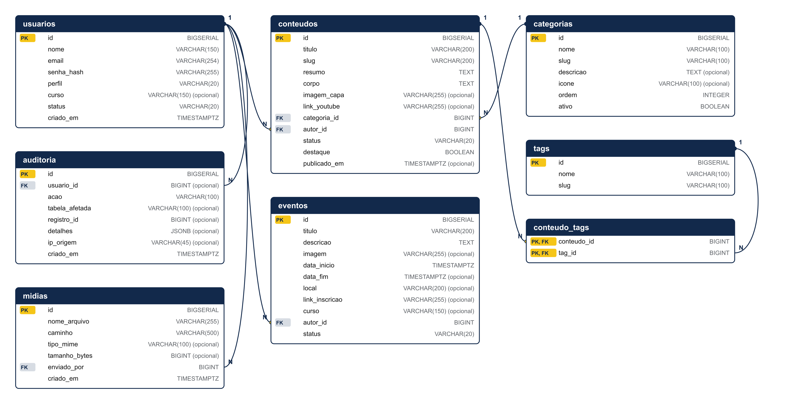

# Modelo de dados

Gerado a partir de `database/schema.sql`. Banco: PostgreSQL (hospedado no Aiven, versão 18.6).

## Diagrama de entidades

Legenda: **PK** chave primária · **FK** chave estrangeira · **1** e **N** indicam a cardinalidade de cada relacionamento (um registro do lado 1 para vários do lado N).

## Relacionamentos

| Tabela (N) | Campo | Tabela (1) | Regra ao excluir |
|---|---|---|---|
| conteudos | categoria_id | categorias | RESTRICT: impede a exclusão se houver registros ligados |
| conteudos | autor_id | usuarios | RESTRICT: impede a exclusão se houver registros ligados |
| conteudo_tags | conteudo_id | conteudos | CASCADE: exclui os registros ligados |
| conteudo_tags | tag_id | tags | CASCADE: exclui os registros ligados |
| eventos | autor_id | usuarios | RESTRICT: impede a exclusão se houver registros ligados |
| midias | enviado_por | usuarios | RESTRICT: impede a exclusão se houver registros ligados |
| auditoria | usuario_id | usuarios | SET NULL: mantém o registro e limpa o campo |

## Dicionário de dados

Campos marcados como **Sim** em "Obrigatório" não aceitam valor nulo. Os campos `imagem_capa` e `link_youtube` (conteudos), `imagem` (eventos) e a tabela `midias` existem no banco, mas são **previstos para a próxima etapa**: ficam fora do escopo avaliado e não foram testados.

### usuarios

Identificação e credenciais de quem acessa o painel.

| Campo | Tipo | Obrigatório | Restrições | Descrição |
|---|---|---|---|---|
| `id` | BIGSERIAL | Sim | PK | Chave primária, gerada automaticamente. |
| `nome` | VARCHAR(150) | Sim | — | Nome completo do usuário. |
| `email` | VARCHAR(254) | Sim | UNIQUE | E-mail de acesso; único no sistema. |
| `senha_hash` | VARCHAR(255) | Sim | — | Senha armazenada somente como hash (password_hash), nunca em texto puro. |
| `perfil` | VARCHAR(20) | Sim | valores: Admin, Professor, Aluno | Papel do usuário: Admin, Professor ou Aluno. |
| `curso` | VARCHAR(150) | Não | — | Curso do usuário (opcional). |
| `status` | VARCHAR(20) | Sim | valores: ativo, inativo; padrão 'ativo' | Situação da conta: ativo ou inativo; só contas ativas entram. |
| `criado_em` | TIMESTAMPTZ | Sim | padrão CURRENT_TIMESTAMP | Data e hora do cadastro, preenchida pelo banco. |

### categorias

Classificação dos conteúdos (as editorias do menu).

| Campo | Tipo | Obrigatório | Restrições | Descrição |
|---|---|---|---|---|
| `id` | BIGSERIAL | Sim | PK | Chave primária, gerada automaticamente. |
| `nome` | VARCHAR(100) | Sim | — | Nome da editoria exibido no menu. |
| `slug` | VARCHAR(100) | Sim | UNIQUE | Endereço amigável da categoria; único. |
| `descricao` | TEXT | Não | — | Texto de apresentação da categoria (opcional). |
| `icone` | VARCHAR(100) | Não | — | Emoji associado à categoria (opcional). |
| `ordem` | INTEGER | Sim | padrão 0 | Posição da categoria no menu. |
| `ativo` | BOOLEAN | Sim | padrão TRUE | Indica se a categoria aparece no portal. |

### conteudos

As publicações do portal, com autor e categoria.

| Campo | Tipo | Obrigatório | Restrições | Descrição |
|---|---|---|---|---|
| `id` | BIGSERIAL | Sim | PK | Chave primária, gerada automaticamente. |
| `titulo` | VARCHAR(200) | Sim | — | Título da publicação. |
| `slug` | VARCHAR(200) | Sim | UNIQUE | Endereço amigável da publicação; único. |
| `resumo` | TEXT | Sim | — | Texto curto exibido nas listas. |
| `corpo` | TEXT | Sim | — | Texto completo da publicação. |
| `imagem_capa` | VARCHAR(255) | Não | — | Caminho relativo da imagem de capa. Previsto para a próxima etapa; existe no banco, mas está fora do escopo avaliado e não foi testado. |
| `link_youtube` | VARCHAR(255) | Não | — | URL de vídeo do YouTube. Previsto para a próxima etapa; existe no banco, mas está fora do escopo avaliado e não foi testado. |
| `categoria_id` | BIGINT | Sim | FK → categorias(id) | Chave estrangeira para categorias (ON DELETE RESTRICT). |
| `autor_id` | BIGINT | Sim | FK → usuarios(id) | Chave estrangeira para o autor em usuarios (ON DELETE RESTRICT). |
| `status` | VARCHAR(20) | Sim | valores: rascunho, publicado, arquivado; padrão 'rascunho' | Estado da publicação: rascunho, publicado ou arquivado. |
| `destaque` | BOOLEAN | Sim | padrão FALSE | Marca a publicação que ocupa a manchete da Home. |
| `publicado_em` | TIMESTAMPTZ | Não | — | Data e hora da publicação; só aparece no portal quando preenchida e publicada. |

### tags

Assuntos que podem marcar um conteúdo.

| Campo | Tipo | Obrigatório | Restrições | Descrição |
|---|---|---|---|---|
| `id` | BIGSERIAL | Sim | PK | Chave primária, gerada automaticamente. |
| `nome` | VARCHAR(100) | Sim | — | Nome do assunto. |
| `slug` | VARCHAR(100) | Sim | UNIQUE | Endereço amigável do assunto; único. |

### conteudo_tags

Ligação N:N entre conteúdos e assuntos.

| Campo | Tipo | Obrigatório | Restrições | Descrição |
|---|---|---|---|---|
| `conteudo_id` | BIGINT | Sim | PK; FK → conteudos(id) | Parte da chave primária; referencia conteudos (ON DELETE CASCADE). |
| `tag_id` | BIGINT | Sim | PK; FK → tags(id) | Parte da chave primária; referencia tags (ON DELETE CASCADE). |

### eventos

Agenda de eventos do curso.

| Campo | Tipo | Obrigatório | Restrições | Descrição |
|---|---|---|---|---|
| `id` | BIGSERIAL | Sim | PK | Chave primária, gerada automaticamente. |
| `titulo` | VARCHAR(200) | Sim | — | Título do evento. |
| `descricao` | TEXT | Sim | — | Descrição completa do evento. |
| `imagem` | VARCHAR(255) | Não | — | Caminho relativo da imagem do evento. Previsto para a próxima etapa; existe no banco, mas está fora do escopo avaliado e não foi testado. |
| `data_inicio` | TIMESTAMPTZ | Sim | — | Data e hora de início. |
| `data_fim` | TIMESTAMPTZ | Não | — | Data e hora de término (opcional). |
| `local` | VARCHAR(200) | Não | — | Local de realização (opcional). |
| `link_inscricao` | VARCHAR(255) | Não | — | Endereço da página de inscrição (opcional). |
| `curso` | VARCHAR(150) | Não | — | Curso relacionado ao evento (opcional). |
| `autor_id` | BIGINT | Sim | FK → usuarios(id) | Chave estrangeira para o autor em usuarios (ON DELETE RESTRICT). |
| `status` | VARCHAR(20) | Sim | valores: rascunho, publicado, arquivado; padrão 'rascunho' | Estado do evento: rascunho, publicado ou arquivado. |

### midias

Registro de arquivos enviados (previsto para a próxima etapa).

| Campo | Tipo | Obrigatório | Restrições | Descrição |
|---|---|---|---|---|
| `id` | BIGSERIAL | Sim | PK | Chave primária, gerada automaticamente. |
| `nome_arquivo` | VARCHAR(255) | Sim | — | Nome original do arquivo enviado. Previsto para a próxima etapa; existe no banco, mas está fora do escopo avaliado e não foi testado. |
| `caminho` | VARCHAR(500) | Sim | — | Caminho do arquivo no servidor. |
| `tipo_mime` | VARCHAR(100) | Não | — | Tipo real do arquivo (MIME). |
| `tamanho_bytes` | BIGINT | Não | — | Tamanho do arquivo em bytes. |
| `enviado_por` | BIGINT | Sim | FK → usuarios(id) | Chave estrangeira para quem enviou o arquivo (usuarios). |
| `criado_em` | TIMESTAMPTZ | Sim | padrão CURRENT_TIMESTAMP | Data e hora do envio. |

### auditoria

Registro de quem fez cada ação no painel.

| Campo | Tipo | Obrigatório | Restrições | Descrição |
|---|---|---|---|---|
| `id` | BIGSERIAL | Sim | PK | Chave primária, gerada automaticamente. |
| `usuario_id` | BIGINT | Não | FK → usuarios(id) | Quem executou a ação; referencia usuarios (ON DELETE SET NULL). |
| `acao` | VARCHAR(100) | Sim | — | Descrição da ação, por exemplo "criou conteúdo". |
| `tabela_afetada` | VARCHAR(100) | Não | — | Tabela em que a ação ocorreu. |
| `registro_id` | BIGINT | Não | — | Identificador do registro afetado. |
| `detalhes` | JSONB | Não | — | Informações adicionais em formato JSON (opcional). |
| `ip_origem` | VARCHAR(45) | Não | — | Endereço IP de origem da requisição. |
| `criado_em` | TIMESTAMPTZ | Sim | padrão CURRENT_TIMESTAMP | Data e hora da ação. |
